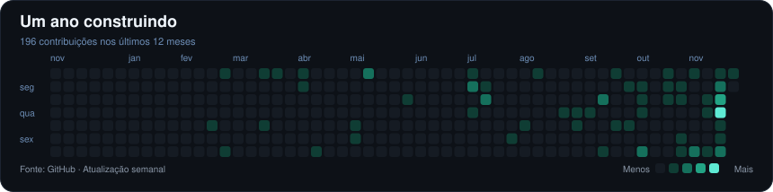
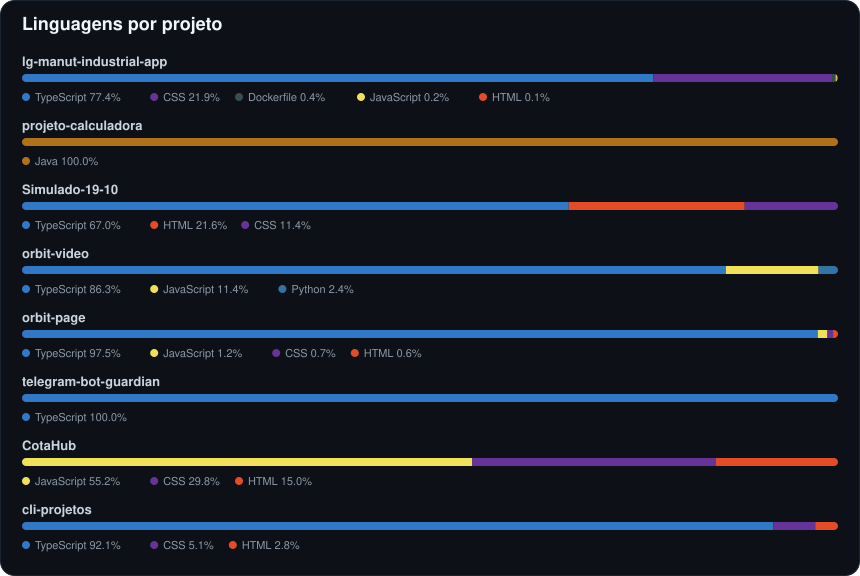

# André Borges

Desenvolvedor na **Solve4ME** · Votorantim, SP

---

## Sobre mim

Sou desenvolvedor na **Solve4ME**, em **Votorantim - SP**, onde desenvolvo aplicações e
soluções utilizando serviços e integrações com a **Genesys Cloud**.

Tenho contribuições em produtos da empresa, como **Upload4ME**, **Tools4ME** e aplicações de
consulta à base de conhecimento de inteligência de bots de atendimento.

No dia a dia trabalho com **TypeScript, React, Docker e AWS**.

### Principais tecnologias

`TypeScript` · `JavaScript` · `Node.js` · `Express` · `PostgreSQL` · `Docker` · `AWS EC2` · `AWS S3` · `Google Cloud` · `Cloudflare` · `Genesys Cloud`

### Outras ferramentas com que tenho experiência

`Java` · `Spring Boot` · `React / TSX` · `SQL Server` · `MySQL` · `Power BI`

---

## Formação

<table>
  <tr>
    <td width="72"></td>
    <td>
      <strong>Centro Universitário Facens</strong> 
      Curso Superior de Tecnologia (CST) em Administração e Gestão de Tecnologia da Informação 
      jan. 2025 – jul. 2027
    </td>
  </tr>
  <tr>
    <td width="72"></td>
    <td>
      <strong>Senai São Paulo</strong> 
      Desenvolvimento de Sistemas · Ensino técnico integrado 
      jan. 2023 – dez. 2024
    </td>
  </tr>
</table>

---

## Atividade

## Linguagens

---

## Orbit

Além do trabalho na Solve4ME, presto serviços de **sites, lojas virtuais e sistemas sob medida** pela
[**Orbit**](https://www.orbit-io.com.br/).

 

---

## Contato

