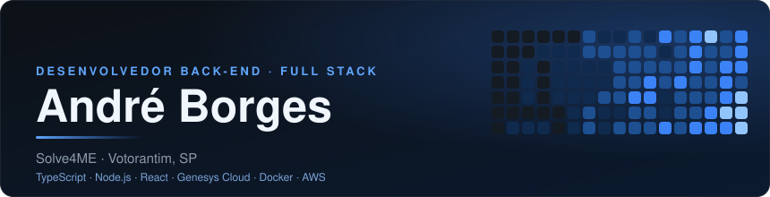

  

  
  
  
  

<h2 align="center">Sobre mim</h2>

Sou desenvolvedor Back-end e atuo como <strong>Full Stack</strong>: trabalho com back-end, front-end, infraestrutura e o que mais o projeto pedir.

<strong>Back-end:</strong> crio aplicações eficientes e integrações de APIs com <strong>TypeScript, Node.js e PostgreSQL</strong>.

<strong>Genesys Cloud:</strong> desenvolvo soluções com a Genesys Cloud API (Conversations, Auth, Data Actions, fluxos e áudios) e customizo aplicações para clientes.

<strong>Infra e deploy:</strong> gerencio aplicações em containers <strong>Docker</strong> na <strong>AWS (EC2 e S3)</strong>, com <strong>CI/CD</strong> e ambientes <strong>Linux</strong>.

<strong>Produtos:</strong> contribuo em produtos da Solve4ME, como <strong>Upload4ME</strong>, <strong>Tools4ME</strong> e aplicações de consulta à base de conhecimento de inteligência de bots de atendimento.

<strong>Front-end:</strong> uso <strong>React e TypeScript</strong> nas aplicações que desenvolvo.

<strong>Origem:</strong> venho de uma base sólida em Suporte e Infraestrutura de TI, com visão sistêmica de redes e monitoramento.

<h2 align="center">Tecnologias</h2>

<table>
  <tr>
    <td width="150"><strong>Back-end</strong></td>
    <td></td>
  </tr>
  <tr>
    <td><strong>Front-end</strong></td>
    <td></td>
  </tr>
  <tr>
    <td><strong>Infra e nuvem</strong></td>
    <td>
      
      
    </td>
  </tr>
  <tr>
    <td><strong>Também conheço</strong></td>
    <td></td>
  </tr>
</table>

<h2 align="center">Formação</h2>

<table>
  <tr>
    <td width="72"></td>
    <td>
      <strong>Centro Universitário Facens</strong> 
      Curso Superior de Tecnologia (CST) em Administração e Gestão de Tecnologia da Informação 
      jan. 2025 – jul. 2027
    </td>
  </tr>
  <tr>
    <td width="72"></td>
    <td>
      <strong>Senai São Paulo</strong> 
      Desenvolvimento de Sistemas · Ensino técnico integrado 
      jan. 2023 – dez. 2024
    </td>
  </tr>
</table>

<h2 align="center">Atividade</h2>

  

<h2 align="center">Linguagens</h2>

  

<h2 align="center">Orbit</h2>

  

  Além do trabalho na Solve4ME, presto serviços de <strong>sites, lojas virtuais e sistemas sob medida</strong> pela
  <a href="https://www.orbit-io.com.br/"><strong>Orbit</strong></a>.

